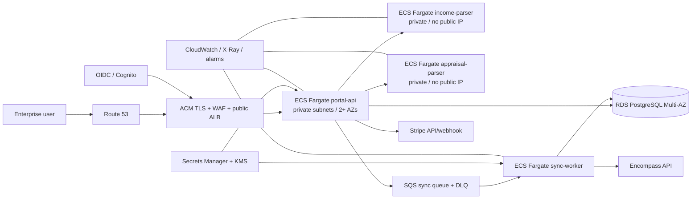

# AWS ECS Deployment Specification

## Target topology

The underwriting console and MinIO are intentionally absent. The console is a
QA tool for a separate non-production account. FreeFlow does not use S3/MinIO to
stage borrower PDFs in production; Encompass remains the source of truth.

## Account and network layout

- Separate AWS accounts for production and non-production under AWS Organizations.
- One VPC per environment across at least two Availability Zones.
- Public subnets contain ALB only. Application, parser, worker, database, and
  cache/endpoint resources use private subnets and no public IP.
- Security groups are identity-oriented:
  - ALB: internet ingress 443; egress only to portal target port.
  - portal: ingress only from ALB; egress to parsers, RDS, SQS/endpoints, and
    approved external APIs.
  - parsers: ingress only from portal; no broad internet egress.
  - worker: no ingress; egress to RDS, SQS/endpoints, Secrets Manager, KMS, and
    Encompass through controlled NAT/egress.
  - RDS: ingress only from portal, worker, and migration-task groups.
- Use interface endpoints for ECR API/DKR, CloudWatch Logs, Secrets Manager, KMS,
  SQS, and related AWS services where cost/operations justify them, plus the S3
  gateway endpoint required for image layer retrieval. External Encompass and
  Stripe access uses controlled NAT egress and DNS/flow-log monitoring.
- Enable VPC Flow Logs. Reject routes that would give parser tasks public ingress.

AWS guidance: [ECS network security](https://docs.aws.amazon.com/AmazonECS/latest/developerguide/security-network.html),
[Fargate security](https://docs.aws.amazon.com/AmazonECS/latest/developerguide/security-fargate.html), and
[Security Hub ECS controls](https://docs.aws.amazon.com/securityhub/latest/userguide/ecs-controls.html).

## Load balancer and authentication

- Route 53 alias -> internet-facing ALB, ACM-managed certificate, HTTPS-only
  listener, modern TLS policy, HTTP redirect to HTTPS.
- AWS WAF managed baseline/IP reputation rules, rate-based controls, endpoint-
  specific limits, and logging with redaction. WAF inspects only a bounded prefix
  of ALB request bodies, so it cannot validate whole PDFs; configure oversize
  handling deliberately and validate the complete document in the service.
- ALB authenticates portal routes with Cognito/OIDC. The portal still verifies the
  signed ALB claim and expected signer, then resolves tenant membership itself.
- The portal target security group accepts only the ALB security group. Health
  paths disclose no versions or dependencies.
- No public target group exists for a parser, worker, database, cache, or console.

Reference: [ALB user authentication](https://docs.aws.amazon.com/elasticloadbalancing/latest/application/listener-authenticate-users.html) and
[WAF body inspection limits](https://docs.aws.amazon.com/waf/latest/developerguide/web-acl-setting-body-inspection-limit.html).

## ECS service translation

| ECS service | Starting task size | Count/scaling | Notes |
|---|---:|---|---|
| `portal-api` | 1 vCPU / 2 GiB | min 2 across AZs; scale on request count, latency, CPU/memory | Next standalone production server; no dev dependencies or fixtures |
| `income-parser` | 2 vCPU / 8 GiB | min based on SLO; one OCR operation per worker; scale on concurrency/latency/CPU | Starting value from existing definition; load test malicious/worst-case PDFs |
| `appraisal-parser` | 1 vCPU / 2 GiB | min based on SLO; scale on concurrency/latency/CPU | Strict production parser, no text-fixture mode |
| `sync-worker` | 0.5 vCPU / 1 GiB | scale on SQS visible messages and oldest age | No listener; bounded concurrency and provider rate limit |

Sizes are hypotheses, not capacity promises. A representative load test sets final
CPU, memory, concurrency, ALB timeout, desired count, scaling cooldown, and cost
budgets. Production portal should normally keep at least two healthy tasks.

Each task definition MUST specify:

- Fargate/`awsvpc`, explicit supported platform version and runtime architecture;
- image by ECR digest, not `latest`;
- distinct task role and execution role;
- non-root user, `readonlyRootFilesystem: true`, dropped capabilities, no
  privileged mode, and an init process where supported;
- CPU/memory reservations/limits and container health check;
- `awslogs` with explicit group, retention, encryption, non-blocking buffer policy
  chosen from measured load, and no multiline body capture;
- non-secret environment values and secret ARNs in `secrets`;
- deployment circuit breaker with rollback, health-check grace, minimum healthy
  percentage, availability-zone rebalancing, and ECS Exec disabled by default;
- deployment tags for git SHA, image digest, schema compatibility, owner, service,
  environment, and data classification.

Fargate does not support Docker `tmpfs`. Parsers must pass tests with a read-only
filesystem and no document writes. Fargate ephemeral storage is encrypted but is
disk-backed and does not satisfy a RAM-only promise.

References: [Fargate task differences](https://docs.aws.amazon.com/AmazonECS/latest/developerguide/fargate-tasks-services.html) and
[ECS deployment circuit breaker](https://docs.aws.amazon.com/AmazonECS/latest/developerguide/deployment-circuit-breaker.html).

## Data, queue, and secrets

- RDS follows `DATABASE-SPEC.md`. A one-off Fargate migration task runs before
  service promotion; it has no ALB and uses a separate migrator role.
- SQS queue and DLQ use SSE-KMS, least-privilege producer/consumer policies,
  visibility timeout longer than bounded work, low maximum receive count, alarms,
  and an explicit retention policy. Payloads contain identifiers only.
- Prefer SQS over Redis for durable Encompass work. If Redis remains for ephemeral
  cache/rate limiting, use ElastiCache in private subnets with TLS, auth, KMS,
  eviction/retention policy, and no sensitive job payload.
- Secrets Manager owns production database, provider, signing, and encryption
  credentials. ECS execution roles may retrieve only named ARNs; task roles get
  only the runtime AWS actions each service needs.
- Secret rotation creates a new secret version and forces a new ECS deployment;
  environment-injected values do not update a running task automatically.

Reference: [Passing Secrets Manager values to ECS](https://docs.aws.amazon.com/AmazonECS/latest/developerguide/secrets-envvar-secrets-manager.html).

## Artifact and delivery pipeline

1. Pull request: lockfile integrity, unit/integration/tenant tests, parser corpus,
   type/lint/build, migration-from-zero and schema-drift tests, SAST, secret scan,
   dependency audit, Dockerfile/IaC policy checks.
2. Merge: build each image once with BuildKit, minimal runtime stages, pinned base
   digest, provenance and SBOM. Push immutable git-SHA tag to ECR.
3. ECR enhanced scanning must finish. Enforce vulnerability policy, sign the
   digest, and record attestations.
4. Deploy digest to staging through IaC, run migrations, smoke/negative/DAST/load
   tests, ZDR log/storage assertions, and approval.
5. Promote the same digest to production. ECS rolling deployment or CodeDeploy
   blue/green uses alarms and automatic rollback. Never rebuild for promotion.

Reference: [ECR tag immutability](https://docs.aws.amazon.com/AmazonECR/latest/userguide/image-tag-mutability.html),
[ECR enhanced scanning](https://docs.aws.amazon.com/inspector/latest/user/scanning-ecr.html), and
[ECR image signing](https://docs.aws.amazon.com/AmazonECR/latest/userguide/image-signing.html).

## Observability and alarms

Create service dashboards and paging alarms for ALB 5xx/target health/latency,
ECS deployment failures/restarts/CPU/memory, RDS connections/storage/replica and
transaction health, parser timeouts/limit rejects, SQS depth/age/DLQ, Encompass
failure rate, Stripe webhook backlog/duplicates, authorization denials, WAF
blocks, and KMS/Secrets access failures. CloudTrail, GuardDuty, Security Hub,
Inspector, AWS Config, and centralized immutable security logs are required by
the organization baseline. CloudWatch data-protection policies mask selected
sensitive patterns but do not replace application-side log exclusion.

## Infrastructure-as-code boundaries

Use one reviewed IaC system (Terraform or AWS CDK) and remote protected state.
Suggested modules/stacks:

1. `account-baseline` — audit/security services and deployment roles;
2. `network` — VPC, subnets, endpoints, NAT/egress, flow logs;
3. `data` — RDS/KMS/Secrets/SQS/DLQ and backup policy;
4. `edge` — Route 53, ACM, WAF, ALB, OIDC;
5. `compute` — cluster, four task definitions/services, autoscaling, discovery;
6. `observability` — logs, dashboards, alarms, notifications;
7. `delivery` — ECR, immutable/scanning/signing policy and CI federation.

No placeholder task-definition JSON is production-ready without the surrounding
network, IAM, secrets, deployment, monitoring, and data controls above. The two
existing parser ECS JSON files should be retired when the selected IaC stack owns
that task definition.

## Required decisions before IaC implementation

- AWS organization/account IDs, home and disaster-recovery regions;
- domain/hostnames and IdP/Cognito ownership;
- Terraform versus CDK and CI provider;
- approved RPO/RTO and audit/financial retention;
- Encompass network/authentication constraints and per-tenant credential model;
- expected document volume, size/page distribution, peak concurrency, and SLOs;
- whether production needs the console (default: no).
